<div align="center">

<!-- ═══════════════════════════ BANNER ═══════════════════════════ -->


<a href="https://git.io/typing-svg">
  
</a>

<br/>


<br/>

### 🛡️ *"You can't defend what you can't see — and you can't see it until you've looked."*

<br/>

**[📖 Overview](#-overview)** &nbsp;•&nbsp;
**[🧰 Toolkit](#-toolkit)** &nbsp;•&nbsp;
**[🔬 Methodology](#-methodology)** &nbsp;•&nbsp;
**[📊 Findings](#-key-findings)** &nbsp;•&nbsp;
**[⚠️ Risks](#%EF%B8%8F-risk-analysis)** &nbsp;•&nbsp;
**[✅ Recommendations](#-recommendations)**

</div>

---

## 📑 Table of Contents

<details open>
<summary><b>Click to expand / collapse</b></summary>

1. [📖 Overview](#-overview)
2. [⚖️ Legal & Ethical Disclaimer](#%EF%B8%8F-legal--ethical-disclaimer)
3. [📋 Report at a Glance](#-report-at-a-glance)
4. [🧰 Toolkit](#-toolkit)
5. [🔬 Methodology](#-methodology)
6. [🧪 Module Walkthroughs](#-module-walkthroughs)
   - [PM1 — Footprinting with Kali Tools](#-pm1--footprinting-with-multiple-kali-tools)
   - [PM2 — Google Hacking Database](#-pm2--google-hacking-database-ghdb)
   - [PM3 — Maltego](#-pm3--maltego-relationship-analysis)
   - [PM4 — theHarvester](#-pm4--passive-recon-with-theharvester)
   - [PM5 — Zenmap Network Scanning](#-pm5--network-discovery-with-zenmap)
7. [📊 Key Findings](#-key-findings)
8. [⚠️ Risk Analysis](#%EF%B8%8F-risk-analysis)
9. [✅ Recommendations](#-recommendations)
10. [📸 Evidence Index](#-evidence-index)
11. [🗂️ Repository Structure](#%EF%B8%8F-repository-structure)
12. [🚀 Getting Started](#-getting-started)
13. [🎓 Skills & Learning Outcomes](#-skills--learning-outcomes)
14. [👤 Author](#-author)
15. [📜 License & Usage](#-license--usage)

</details>

---

## 📖 Overview

This repository holds my **Week 2 Penetration Testing Report** for the **Cybersecurity & Ethical Hacking** program at **Networkwalks**. It records, step by step, how I moved through the first two phases of a security assessment: **reconnaissance & footprinting** and **scanning & network discovery**.

Every activity was performed in **Kali Linux**. Reconnaissance relied only on **publicly available information**, and all active scanning was carried out against **my own local LAN**.

For each exercise, the report documents:

| 🔹 | What it covers |
|:--:|:---------------|
| **1** | The command or method that was used |
| **2** | The result that was observed |
| **3** | Why that result matters from a security point of view |
| **4** | The risk it may create and how to reduce it |
| **5** | Screenshot evidence with a short description |

> 💡 **Important:** Everything in this project is an *observation* from information gathering and host discovery. **No exploitation or vulnerability validation was performed.** Seeing a version number, IP address or DNS record does not, on its own, prove that a system is vulnerable.

<div align="center">

### 🎯 Mission Snapshot

| 🌐 Targets | 🧰 Tools | 📦 Modules | 📸 Screenshots | ⚠️ Risks Logged | ✅ Recommendations |
|:---:|:---:|:---:|:---:|:---:|:---:|
| **2** | **10+** | **5** | **11** | **8** | **12** |

</div>

---

## ⚖️ Legal & Ethical Disclaimer

<table>
<tr>
<td width="60" align="center">🚨</td>
<td>

**Read this before you do anything else.**

All work shown here was done **strictly inside the assigned educational cybersecurity scope**, on systems and devices that I own or was authorised to assess. The material is shared for **education and research only**.

- ❌ Do **not** use anything in this repository to break the law.
- ❌ Do **not** test systems you do not own or have written permission to test.
- ⚖️ Unauthorised access can be a **criminal offence** even when no damage is caused.
- 🏫 The instructor, the authors and Networkwalks are **not responsible** for misuse of this knowledge.
- 👤 Anyone acting outside an authorised scope is **personally accountable** for their actions.

</td>
</tr>
</table>

---

## 📋 Report at a Glance

<div align="center">

| | |
|:--|:--|
| 👤 **Name** | Shan Rasool |
| 🎓 **Program / Batch** | B083 – Networkwalks |
| 📅 **Date** | 5 October 2026 |
| 🏷️ **Report ID** | W2-PM-FINAL |
| 🎯 **Client / Target** | 1. `networkwalks.com` (assigned educational reconnaissance target) <br/> 2. My own local LAN |
| ✅ **Permission secured** | Yes — within the assigned educational scope and on my own network |
| 🧭 **Phases covered** | Phase 1: Reconnaissance & Footprinting <br/> Phase 2: Scanning & Network Discovery <br/> Phases 3–5: Reconnaissance exercises & supporting information gathering |

</div>

### 📦 Modules Completed

| Module | Topic | Focus |
|:------:|:------|:------|
| **W2-PM1** | Multiple Kali Tools | WHOIS, WhatWeb, Nslookup, Curl, Wafw00f, DNSRecon |
| **W2-PM2** | GHDB | Search-engine reconnaissance with Google operators |
| **W2-PM3** | Maltego | Entity graphing and transforms |
| **W2-PM4** | theHarvester | Passive collection of hosts, emails and IPs |
| **W2-PM5** | Zenmap Scanning | Live-host discovery and network topology |

---

## 🧰 Toolkit

<div align="center">

| 🛠️ Tool | 🎯 Purpose |
|:--------|:-----------|
| 🐉 **Kali Linux** | Operating system used for reconnaissance, passive information gathering and network scanning |
| 🔎 **WHOIS** | Retrieves public domain registration details, key dates and name servers |
| 🧬 **WhatWeb** | Fingerprints the web technologies, CMS and plugins visible on a site |
| 🌍 **nslookup** | Resolves a domain name to its IP address through DNS |
| 📨 **curl -I** | Fetches the HTTP response headers returned by the website |
| 🧱 **wafw00f** | Checks whether a Web Application Firewall can be identified publicly |
| 📡 **dnsrecon** | Enumerates DNS records such as NS, MX, SPF, TXT and service records |
| 🕵️ **Google / GHDB** | Carries out search-engine reconnaissance using specialised operators |
| 🕸️ **Maltego** | Builds a visual graph of entities and relationships and runs transforms |
| 🌾 **theHarvester** | Gathers public emails, hosts, IPs and related data from supported sources |
| 🗺️ **Zenmap / Nmap** | Discovers live hosts on the authorised subnet and draws the network topology |

</div>

---

## 🔬 Methodology

The assessment followed a classic **outside-in** flow: start with what anyone on the internet can see, then move to the local network.

```mermaid
flowchart LR
    A([🎯 Define Scope<br/>& Permission]) --> B[🔎 Footprinting<br/>WHOIS · WhatWeb · DNS]
    B --> C[🕵️ Search-Engine Recon<br/>GHDB]
    C --> D[🕸️ Relationship Mapping<br/>Maltego]
    D --> E[🌾 Passive Harvesting<br/>theHarvester]
    E --> F[🗺️ Network Discovery<br/>Zenmap / Nmap]
    F --> G[⚠️ Risk Analysis]
    G --> H([✅ Recommendations])

    style A fill:#1a1a2e,color:#fff,stroke:#B71C1C
    style H fill:#2E7D32,color:#fff,stroke:#1b5e20
    style G fill:#E65100,color:#fff,stroke:#bf360c
```



### 🧭 Phase Mapping

| Phase | Name | Modules |
|:-----:|:-----|:--------|
| **1** | Reconnaissance & Footprinting | PM1, PM2, PM3, PM4 |
| **2** | Scanning & Network Discovery | PM5 |
| **3 – 5** | Reconnaissance exercises & supporting information gathering | Supporting work across modules |

---

## 🧪 Module Walkthroughs

### 🔹 PM1 — Footprinting with Multiple Kali Tools

Six tools were used against `networkwalks.com`, and each one revealed a different slice of publicly observable information.

| Step | Tool | What it revealed |
|:----:|:-----|:-----------------|
| 1️⃣ | **WHOIS** | Domain registration details and name servers, which describe how the domain is registered and hosted |
| 2️⃣ | **WhatWeb** | **WordPress 7.0.4** and **WP Download Manager 3.3.58**, plus other exposed details |
| 3️⃣ | **Nslookup** | The domain resolves to **`192.232.216.135`** |
| 4️⃣ | **Curl -I** | HTTP response headers and the exposed WordPress REST API endpoint **`/wp-json/`** |
| 5️⃣ | **Wafw00f** | A Web Application Firewall: **ModSecurity (SpiderLabs)** |
| 6️⃣ | **DNSRecon** | Name servers, mail servers, SPF/TXT records, service records and DNS software information |

<details>
<summary>💻 <b>Command pattern reference</b></summary>

```bash
whois networkwalks.com            # registration details & name servers
whatweb networkwalks.com          # web technology fingerprinting
nslookup networkwalks.com         # DNS resolution to IP
curl -I https://networkwalks.com  # HTTP response headers
wafw00f https://networkwalks.com  # WAF detection
dnsrecon -d networkwalks.com      # DNS record enumeration
```

</details>

---

### 🔹 PM2 — Google Hacking Database (GHDB)

GHDB introduced **search-engine reconnaissance** with specialised Google operators. Two exercises were completed and logged in a worksheet:

| Exercise | Entries recorded | Notes |
|:---------|:----------------:|:------|
| 📷 **Security-camera search** | **10** | Sources included Alliance for Coastal Technologies, Course Hero, Exploit-DB, Accio Work, Blogger and others. Only the *sources* are logged — no camera-access URLs or credentials are reproduced. |
| 📚 **Mathematics directory listings** | **10** | Open "Index of" listings hosting mathematics PDFs from universities and public archives. |

> 🧠 **Takeaway:** Search engines can unintentionally index information that helps an attacker profile a target — long before any scanning begins.

---

### 🔹 PM3 — Maltego Relationship Analysis

A **Domain entity** for `networkwalks.com` was created and the transform **`[Utilities] To Emails @domain [Search Engine]`** was run on it.

| Item | Result |
|:-----|:-------|
| Domain entity | `networkwalks.com` |
| Entities processed | 1 |
| Execution status | ✅ Completed |
| Credits consumed | 10 unified credits |
| Credits remaining | 190 |
| Visible graph result | Domain node remained visible; no additional linked entity appeared |

---

### 🔹 PM4 — Passive Recon with theHarvester

`microsoft.com` was the module-specified passive reconnaissance target.

| Task | Command | Observed result |
|:----:|:--------|:----------------|
| **1** | `theHarvester -d microsoft.com -l 1000 -b baidu` | 0 IPs · 0 emails · 0 people · **2 hosts**: `cla.opensource.microsoft.com`, `support.microsoft.com` |
| **2** | `theHarvester -d microsoft.com -l 50 -b all` | All-source output captured separately as raw evidence because it was too large to reproduce in full |

---

### 🔹 PM5 — Network Discovery with Zenmap

Performed on my **own local network**.

```text
Interface : eth0
Address   : 10.0.0.3/24
Subnet    : 10.0.0.0/24
Scan      : nmap -sn 10.0.0.0/24   (Ping Scan — 256 addresses)
Result    : 3 live hosts
```

| 🌐 IP Address | 🔖 MAC Address | 📶 Status |
|:-------------|:---------------|:---------|
| `10.0.0.1` | `52:54:00:12:35:00` | 🟢 Up |
| `10.0.0.2` | `08:00:27:53:38:90` | 🟢 Up |
| `10.0.0.3` | `08:00:27:5A:87:BC` | 🟢 Up — Kali host |

The MAC address of `10.0.0.3` was cross-checked with `ip link show eth0`, and a **network topology** was generated from Zenmap's Topology tab.

---

## 📊 Key Findings

<div align="center">

| 🔍 Area | 📌 Finding |
|:-------|:-----------|
| 🌐 **Web stack** | WordPress 7.0.4 with WP Download Manager 3.3.58 |
| 📍 **Server IP** | `192.232.216.135` |
| 🔗 **API exposure** | WordPress REST API path `/wp-json/` visible in headers |
| 🧱 **WAF** | ModSecurity (SpiderLabs) detected |
| 📡 **DNS** | NS, MX, SPF/TXT and service records enumerated |
| 🕵️ **Search indexing** | 10 camera-related results + 10 open directory listings documented |
| 🕸️ **Maltego** | Transform succeeded; 10 credits used, 190 remaining |
| 🌾 **theHarvester** | 2 public hostnames found via Baidu |
| 🗺️ **Local network** | 3 live hosts in `10.0.0.0/24` |

</div>

---

## ⚠️ Risk Analysis

> These are **observations**, not confirmed vulnerabilities. Further *authorised* testing would be required to validate any of them.

| # | Risk / Finding | Evidence | Potential Impact | Level |
|:-:|:---------------|:---------|:-----------------|:-----:|
| 1 | Web technology details exposed | WhatWeb identified WordPress and WP Download Manager | Visible technology and version data helps attackers pick software worth targeting | 🟠 **Medium** |
| 2 | Server IP address discoverable | Nslookup resolved the domain to `192.232.216.135` | Reveals where the web service sits on the network | 🟢 **Low** |
| 3 | HTTP technical details exposed | Curl returned headers and revealed `/wp-json/` | Supports fingerprinting and deeper enumeration | 🟢 **Low** |
| 4 | WAF identifiable | Wafw00f detected ModSecurity (SpiderLabs) | Discloses part of the application's defensive set-up | 🟢 **Low** |
| 5 | DNS infrastructure details exposed | DNSRecon listed DNS, mail and service records | Helps an outsider build a wider infrastructure profile | 🟠 **Medium** |
| 6 | Publicly indexed information discoverable | GHDB returned camera-related and directory-listing results | Search indexing can expose data that aids profiling | 🟠 **Medium** |
| 7 | Public-source host data collected | theHarvester found two `microsoft.com` hostnames | Supports external reconnaissance and infrastructure mapping | 🟢 **Low** |
| 8 | Several live hosts on local network | Zenmap found three live hosts in `10.0.0.0/24` | Unknown or unauthorised devices could be present | 🟠 **Medium** |

<div align="center">

**Risk key:** &nbsp; 🔴 Critical &nbsp;•&nbsp; 🟠 Medium &nbsp;•&nbsp; 🟢 Low

| 🔴 Critical | 🟠 Medium | 🟢 Low |
|:-----------:|:---------:|:------:|
| **0** | **4** | **4** |

</div>

---

## ✅ Recommendations

<details open>
<summary><b>🔐 Defensive improvements suggested by this assessment</b></summary>

<br/>

| # | Recommendation | What to do |
|:-:|:---------------|:-----------|
| 1 | **Review publicly exposed technology information** | Regularly check which web technologies, CMS platforms and plugins are visible to outsiders |
| 2 | **Keep software updated** | Update CMS, plugins and components; compare against current security advisories |
| 3 | **Review HTTP headers** | Make sure no unnecessary technical details are revealed |
| 4 | **Review DNS records regularly** | Audit DNS so only required information and services are public |
| 5 | **Configure and monitor the WAF properly** | Keep it on and tuned; review rules and logs regularly |
| 6 | **Review search-engine indexing** | Periodically check for content that should not be indexed |
| 7 | **Review public directories and files** | Restrict open listings that are not meant to be public |
| 8 | **Review external information exposure** | Run passive recon periodically to see what an outsider can collect |
| 9 | **Perform regular internal network discovery** | Scan your own networks to identify active devices |
| 10 | **Investigate unknown devices** | Verify any unexpected device found during scanning |
| 11 | **Maintain network documentation** | Keep topology and device inventories current |
| 12 | **Test security only with authorisation** | Scan and probe only where proper permission exists |

</details>

---

## 📸 Evidence Index

Every screenshot in the report includes a short description. The index below lists all of them in order.

| # | Module | Evidence | What it shows |
|:-:|:------:|:---------|:--------------|
| 1 | PM1 | 🔎 WHOIS output | Registrar, dates and name servers for the domain |
| 2 | PM1 | 🧬 WhatWeb output | Detected technology stack including WordPress and the download plugin |
| 3 | PM1 | 🌍 Nslookup output | Domain resolved to `192.232.216.135` |
| 4 | PM1 | 📨 Curl HTTP headers | Response headers and the exposed `/wp-json/` path |
| 5 | PM1 | 🧱 Wafw00f output | ModSecurity (SpiderLabs) identified |
| 6 | PM1 | 📡 DNSRecon output | NS, MX, SPF/TXT and service records |
| 7 | PM3 | 🕸️ Maltego domain graph | `networkwalks.com` as a Domain entity |
| 8 | PM3 | ⚙️ Maltego transform output | Transform completed; 10 credits used, 190 left |
| 9 | PM4 | 🌾 theHarvester all-source raw output | Large raw output for `microsoft.com` (limit 50) |
| 10 | PM5 | 📶 Zenmap Ping Scan | `nmap -sn 10.0.0.0/24` — 3 live hosts with IP and MAC |
| 11 | PM5 | 🗺️ Zenmap topology | Visual layout of hosts on `10.0.0.0/24` |

---

## 🗂️ Repository Structure

> A suggested layout — adjust it to match your own repository.

```text
📦 week-2-pentest-report
 ┣ 📜 README.md
 ┣ 📄 Shan_week_2_report_nw_revised.docx    ← Final report
 ┣ 📂 screenshots
 ┃ ┣ 🖼️ 01-whois.jpg
 ┃ ┣ 🖼️ 02-whatweb.jpg
 ┃ ┣ 🖼️ 03-nslookup.jpg
 ┃ ┣ 🖼️ 04-curl-headers.jpg
 ┃ ┣ 🖼️ 05-wafw00f.jpg
 ┃ ┣ 🖼️ 06-dnsrecon.jpg
 ┃ ┣ 🖼️ 07-maltego-graph.jpg
 ┃ ┣ 🖼️ 08-maltego-transform.jpg
 ┃ ┣ 🖼️ 09-theharvester-all.jpg
 ┃ ┣ 🖼️ 10-zenmap-ping-scan.jpg
 ┃ ┗ 🖼️ 11-zenmap-topology.jpg
 ┗ 📂 raw-output
   ┗ 📝 theharvester-all-sources.txt
```

---

## 🚀 Getting Started

### 📥 Read the report

```bash
# 1. Clone the repository
git clone https://github.com/<your-username>/<your-repo>.git

# 2. Enter the folder
cd <your-repo>

# 3. Open the report in Word, LibreOffice or any DOCX viewer
```

### 🧪 Practise the techniques safely

If you want to repeat these exercises, do it **only in a lab you control**:

| ✅ Safe | ❌ Never |
|:--------|:---------|
| Your own virtual machines and home network | Someone else's network or devices |
| Targets that give explicit written permission | Sites you merely *found* online |
| Intentionally vulnerable practice labs | Any production system without authorisation |

> 📝 **Tip:** Write down your scope and permission *before* running a single command. It is the habit that separates a security professional from an intruder.

---

## 🎓 Skills & Learning Outcomes

<div align="center">

| 🧠 Skill | 📈 What I practised |
|:--------|:--------------------|
| **Footprinting** | Collecting domain, hosting, DNS and technology data from public sources |
| **Search-engine intelligence** | Using GHDB operators to locate publicly indexed information |
| **Relationship mapping** | Building entity graphs and running transforms in Maltego |
| **Passive reconnaissance** | Harvesting hosts, IPs and emails without touching the target |
| **Network discovery** | Ping scanning, host identification, MAC lookup and topology mapping |
| **Risk assessment** | Rating observations by likelihood and impact |
| **Professional reporting** | Explaining what was done, found, why it matters, and how to fix it |
| **Ethics & scope** | Working only within authorised boundaries |

</div>

### 💭 What I Took Away

- 🔍 Even **before any exploitation**, careful analysis of public information and network responses reveals a great deal about an environment.
- 📝 A good report explains **what was done, what was found, what it means, what risk it creates and how to reduce it**.
- ⚖️ Reconnaissance and scanning must **always** stay within an authorised scope.

---

## 👤 Author

<div align="center">


**Shan Rasool**
*Cybersecurity & Ethical Hacking Program*

<br/>

[](https://github.com/shan-rasool)
[](https://www.linkedin.com/in/shan--rasool)
[](mailto:shanrasool2002@gmail.com)

</div>

---

## 📜 License & Usage

This project is shared for **educational and research purposes only**.

- ✅ You may read, learn from and reference this report with credit.
- ❌ You may not use it to target, scan or attack any system without explicit authorisation.
- ⚖️ The author and Networkwalks accept no liability for misuse.

---

<div align="center">

### ⭐ If this report helped you learn, consider giving the repo a star!

**Stay curious. Stay ethical. Stay authorised.** 🛡️


</div>
